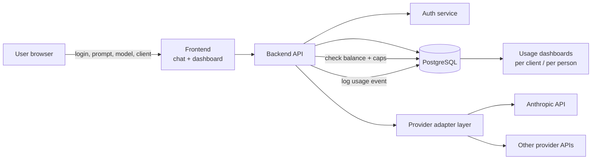

# 04 — Architecture

Status: **draft for Phase 1.** Don't build before the Phase 0 go decision.

## Concept: an AI gateway

Users never see the API key. The backend checks the balance, calls the model, logs usage
against user + client, and deducts credits.



## Request flow

1. User sends prompt + chosen model + client tag.
2. Backend checks: is the user active? Are there credits left? Is the user under the
   daily and per-user cap?
3. Backend calls the model through the adapter; the answer streams back to the user.
4. When the stream ends, backend writes a `usage_event` (input/output tokens, model,
   cost, user, client, workspace).
5. Backend writes a matching debit to `credit_ledger`.

## Stack (proposed)

| Layer | Choice | Notes |
|---|---|---|
| Base app (Phase 1) | Open-source chat UI (LibreChat or Open WebUI) | Licence check first: ADR 0002 |
| Frontend (custom, later) | Next.js / React | Only if the base UI limits us |
| Backend | FastAPI (Python) or Node.js | Python fits founder's data stack |
| Database | PostgreSQL | Users, chats, usage, credits |
| Auth | Clerk / Auth0 / Supabase Auth | Don't build login yourself |
| Payments | Local: SSLCommerz / bKash; International: Stripe or Paddle (verify availability) | Manual invoices in Phase 1 |
| Hosting | Small VPS or Vercel + small backend host | |
| Analytics | SQL views → Power BI or a built-in dashboard | Founder's strength |

## Core data model (draft)

```
workspace(id, name, plan, monthly_cap)
user(id, workspace_id, email, role[admin|member], daily_cap, status)
client(id, workspace_id, name)                       -- the agency's end client
conversation(id, workspace_id, user_id, client_id, model, created_at)
message(id, conversation_id, role, content, created_at)
prompt_template(id, workspace_id, title, body, category, created_by)
usage_event(id, workspace_id, user_id, client_id, conversation_id,
            provider, model, input_tokens, output_tokens, cost_usd, created_at)
credit_ledger(id, workspace_id, amount_usd, type[topup|debit|refund], ref, created_at)
```

`usage_event.client_id` is what makes per-client reporting possible. Treat it as a
required field from day one.

## Model tiers in the picker

Keep model IDs in config, not in code. Example tiers for Anthropic (verify the current
IDs and prices on the provider's docs before launch):

| Tier | Example model |
|---|---|
| Fast / cheap | `claude-haiku-5-5` |
| Balanced | `claude-sonnet-5-5` |
| Strongest | `claude-opus-5-5` |

## Security rules

- API keys: server-side env vars or a secret manager only. Never in frontend, git, or chat.
- Hard caps are enforced on the server, never only in the UI.
- Every query is scoped by `workspace_id`, so client data never leaks across workspaces.
- Users can delete chats; publish a plain data-retention policy.
- Pass provider usage policies through in your Terms of Service, and keep a way to block
  abusive users.
